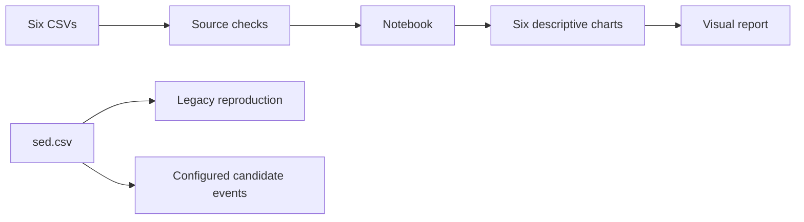
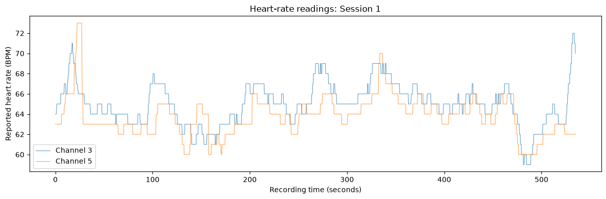
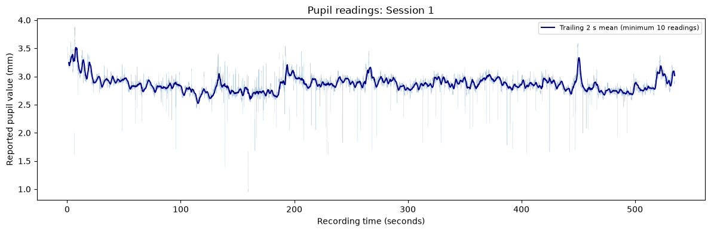
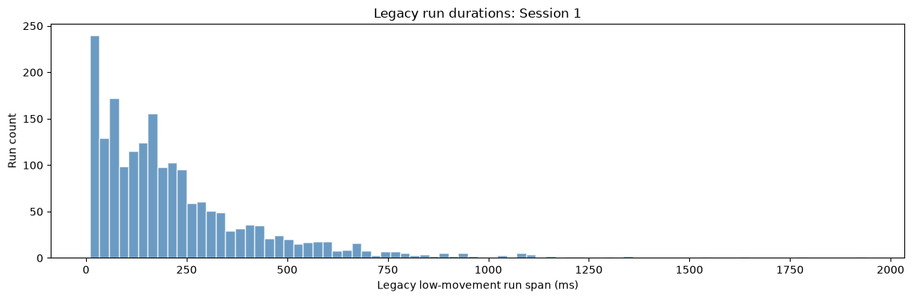
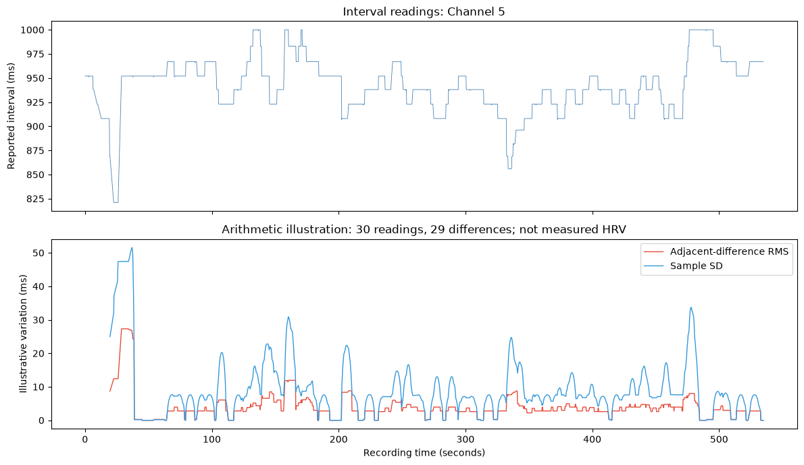
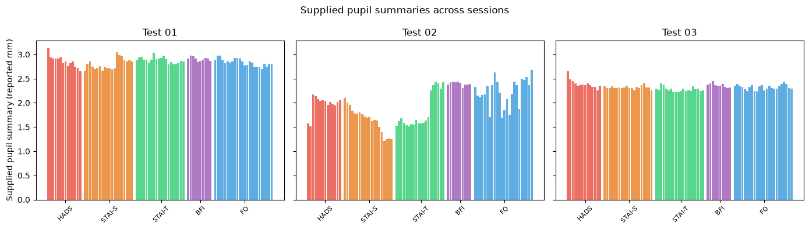
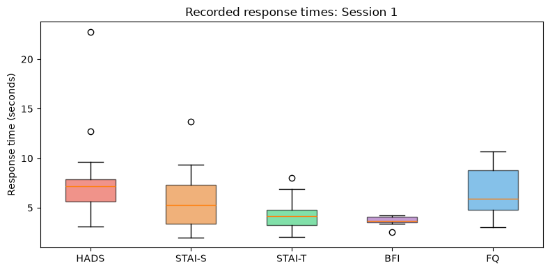

# Sensor

Sensor contains recordings from one participant and Python code for descriptive analysis. It uses NumPy, pandas and Matplotlib to load the CSVs, check their structure and clocks, and plot heart rate, pupil readings, interval samples and questionnaire response times.

Raw sensor and questionnaire data cover Session 1. Supplied eye summaries cover three sessions. The repository also preserves seven historical reviews of 11 devices and two facial analysis tools. Reviewed equipment has not been mapped to the recorded channels.

[View the charts](https://urmeo.github.io/sensor/) · [Pipeline and folder guide](docs/PIPELINE.md)



<table>
<tr>
<td></td>
<td></td>
</tr>
<tr>
<td></td>
<td></td>
</tr>
<tr>
<td></td>
<td></td>
</tr>
</table>

## Run the analysis

Use Python 3.11 or later. From a source checkout:

```bash
python -m venv .venv
source .venv/bin/activate
python -m pip install -e ".[dev]"
python -m scripts.derive --check
python -m scripts.validate_provenance
python -m scripts.export_figures --output-dir outputs/figures
```

The checks compare the historical gaze calculation and recording inventory with the supplied files. The exporter executes the notebook and writes six PNG charts with a hash manifest. These commands leave the source data unchanged.

Open the [exploration notebook](notebooks/explore_data.ipynb) in a notebook editor, or execute it with:

```bash
python -m pytest --nbmake --nbmake-timeout=600 notebooks/explore_data.ipynb
```

The installed wheel contains code only. For CSV commands, pass `--data-dir /path/to/data`; for Python loading, use `sensor_data.load("sed", base="/path/to/data")`. The provenance validator requires a source checkout and accepts `--root /path/to/checkout`. See [contributing](CONTRIBUTING.md) for pinned dependencies and verification commands.

## Data and methods

| File | Rows | Content |
| --- | ---: | --- |
| `hr.csv` | 4,032 | Heart-rate samples |
| `ibi.csv` | 2,394 | Sampled intervals |
| `sed.csv` | 34,171 | Gaze, eye openness and pupil readings |
| `sed_fix.csv` | 34,171 | Eye readings with historical low-movement flags |
| `eye_metrics.csv` | 264 | Supplied eye summaries: 88 questions across three sessions |
| `Psychometric_Test_Results.csv` | 88 | Session 1 responses and timing |

The [data dictionary](data/DATA_DICTIONARY.md) explains fields and units. The [schema](datapackage.json) records types and constraints. The [recording manifest](data/RECORDING_PROVENANCE.json) records source hashes, sessions, channels and missing acquisition evidence.

`sed_fix.csv` preserves the legacy gaze calculation. It ignores quality and gaps and does not establish physiological fixations. The separate [candidate event detector](docs/FIXATION_DETECTOR.md) requires displacement, quality, maximum-gap and minimum-duration settings. It writes a separate event table and records the parameters and source file. Its boundary behavior is tested on synthetic inputs; fixation accuracy and suitable device-specific thresholds remain unverified.

## Limits

- This one-participant sample is used for descriptive analysis. The project provides no validated anxiety classifier or diagnostic or population results.
- Sensor and eye timestamps have unspecified time zones; questionnaire timestamps use UTC. Cross-stream alignment is unverified.
- Device mappings, calibration and coordinate units are undocumented. Pupil millimetres are reported units.
- Repeated, quantized interval samples are not a verified beat sequence and do not establish cardiac HRV.
- Supplied summary aggregation, baseline intervals and blink rules are unavailable. Raw recordings for Sessions 2–3 are absent.

## Reviews and rights

The [historical reviews](docs/reviews/) remain as supplied. [NOTICE](NOTICE.md) records corrections, sources and rights; [image credits](docs/images/CREDITS.md) identify product media.

Code uses the [MIT license](LICENSE). Authored observations and documentation use [CC BY 4.0](LICENSE-DATA) where the author holds rights. Questionnaire wording and product media retain third-party rights; instrument redistribution permission is unestablished. Read the [consent and privacy statement](DATA_ETHICS.md) before using the data. [Citation metadata](CITATION.cff) is included.

Related projects: [Multimodal-Multisensor](https://github.com/urmeo/multimodal-multisensor) and [CalmSense](https://github.com/urmeo/calm-sense).
