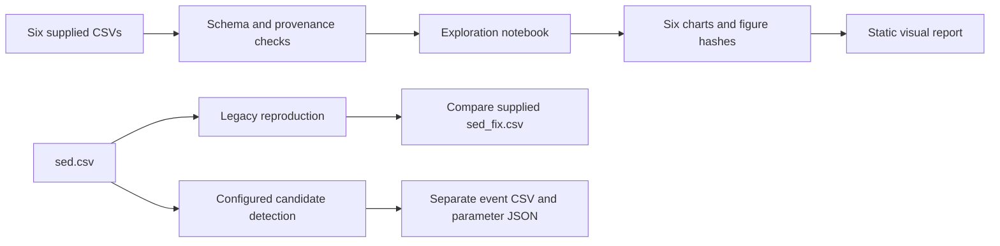

# Analysis and publishing pipeline

The source files stay in `data/`. Checks run before publishing. The notebook
produces six descriptive charts; it does not train a classifier.



`sed_fix.csv` supplies the notebook's historical run histogram. Reproducing its
flags does not validate fixation accuracy. Candidate events use a separate
command and are not included in the six charts. Supplied eye summaries and
questionnaire timing are independent inputs; clock alignment and summary
aggregation remain unverified.

From an installed source checkout:

```bash
python -m pytest tests/ -q
python -m scripts.derive --check
python -m scripts.validate_provenance
python -m scripts.export_figures --output-dir outputs/figures
```

The exporter executes the notebook in memory. It writes six numbered PNGs and a
`figures.json` file with source and figure hashes. It leaves the notebook and CSVs
unchanged. Install the development dependencies to use the notebook exporter.

| Folder | Contents |
| --- | --- |
| `data/` | Six source CSVs, field dictionary and recording manifest |
| `notebooks/` | Descriptive analysis and chart definitions |
| `scripts/` | Legacy reproduction, candidate events, time export, provenance checks and figure export |
| `tests/` | Source contracts and synthetic regression cases |
| `docs/figures/` | Versioned chart previews and their hash manifest |
| `docs/reviews/` | Original historical PDFs |
| `docs/images/` | Reviewed product images and their credits |
| `docs/index.html` | Static visual report |
| `outputs/` | Ignored local exports, including candidate events and relative-time copies |

The verification workflow checks Python 3.11 and 3.12. On `main`, publishing waits
for both test jobs. It then regenerates the figures and deploys only the HTML
report and generated charts to GitHub Pages. It makes no generated commits.
